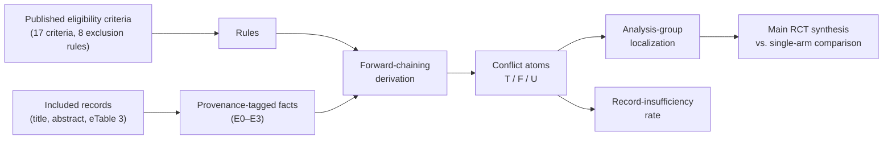

<div align="center">

# Bounded Auditability of Medical Knowledge

**Can eligibility criteria in published systematic reviews be turned into replayable audit traces — and which modeling choices does such a trace depend on?**

[](LICENSE-CC-BY-4.0.txt)
[](LICENSE-MIT.txt)
[](https://www.python.org/)
[](#status-and-roadmap)
[](#status-and-roadmap)

[Manuscript](manuscript/论文初稿-医学知识有界公理化.md) ·
[First-round review](manuscript/模拟审稿报告-医学知识有界公理化.md) ·
[Second-round review](manuscript/模拟审稿报告-v0.2复审.md) ·
[Supplement](supplement/README.md) ·
[Reproduce](#reproduce) ·
[中文](#中文摘要)

</div>

---

## Why this repository exists

A published systematic review states its eligibility criteria and reports an included set. Are the two actually consistent? Most audits stop at “a conflict exists”. This project asks a narrower, more operational question:

> Given the published criteria, the published included records, and the published evidence, can we derive a **conflict trace** that another reader can replay — and can we say **where in the analysis** that conflict lands?

The case study is Sorin et al. 2024 (*JAMA Oncology*), a meta-analysis of neoadjuvant chemoimmunotherapy for NSCLC: 42 publications + 6 conference abstracts = **48 records**, **43 trials**, **54 arms**, 5,431 patients. The audit is supplemented by 11 purposively sampled 2026 meta-analyses and 5 full-record audits.

The project is deliberately **bounded**: it does not claim that medical knowledge can be axiomatized globally. It claims that a slice of the A-layer (definitional/classificatory criteria) can be made **auditable**, and it shows where that audit breaks.

---

## The audit in one picture



The key move is the last one: a conflict is not just “found”; it is located in the analysis group where it matters. In the Sorin case, the P4 conflicts sit in the **27 single-arm chemotherapy arms**, not in the **8 chemoimmunotherapy RCTs** — so they affect the single-arm comparison, not the main RCT synthesis. The manuscript is explicit that this is **definitional**, not an audit finding of “harmlessness”.

---

## Headline results

| Result | Value |
|---|---|
| Records / trials / arms | **48 / 43 / 54** (42 publications + 6 abstracts) |
| Conflict atoms at record level | **11** — 7 E1 abstract-level, 4 E0 title-level |
| Retracted after abstract check | **1** — S31/P4 (mixed EGFR population: 15 mutant + 16 wild-type) |
| Record-insufficiency rate | **71.4%** (95% CI 66.6–75.6) record level; **68.0%** (63.1–72.4) arm level |
| Residual records after joint revision | **3** — S31/T2 (E1), S42/T2 (E0), S46/D2 (E0, provisional) |
| Cross-case criteria | **114** criteria from 11 meta-analyses; **91.2%** formalizable, **61.4%** title/abstract-visible |
| Full-record audits | 5 cases, 6 grids, **1,078 codes** (694 unique cells, 79 independent units) |
| Record insufficiency, homogeneous cases | **8.3%–16.7%** (RCT, dose-response, IPD, umbrella) vs. **68.0%–71.4%** (mixed-design Sorin) |

> The headline is not the conflict count. It is the **record-insufficiency rate**: roughly seven in ten judgment cells have no published fact, so “no conflict found” usually means “not yet decidable”, not “clean”.

---

## What is new

The contribution is **not** any single technique. Rule-based criteria, forward chaining, provenance-tagged facts, and three-valued judgments all overlap with existing work in ontology, guideline formalization, and screening automation. The contribution is the **combination**, under four explicit conditions:

| Condition | What it means | Why it matters |
|---|---|---|
| **Post hoc** | Audit published criteria and a published included set; do not re-screen or re-run the meta-analysis | Keeps the object of audit fixed and reproducible |
| **Machine-replayable** | Every conflict derivation can be replayed to its source facts | A reader can disagree with a fact or a rule without losing the trace |
| **Provenance** | Every fact carries a source and an evidence level (E0 title, E1 abstract, E2 full text, E3 author/protocol) | Separates “the trace is valid” from “the fact is true” |
| **Analysis-group localization** | Map each conflict to the specific synthesis it affects | Distinguishes “main RCT conclusion changed” from “single-arm comparison affected” |

The manuscript calls this **bounded auditability**, not axiomatization. The A-layer can be audited; the B-layer (process/protocol) is untested; the C-layer (empirical/causal) is argued, not proved.

---

## Repository map

| Path | Contents |
|---|---|
| [`manuscript/论文初稿-医学知识有界公理化.md`](manuscript/论文初稿-医学知识有界公理化.md) | Manuscript v0.3 (Chinese) |
| [`manuscript/模拟审稿报告-医学知识有界公理化.md`](manuscript/模拟审稿报告-医学知识有界公理化.md) | First-round simulated review (v0.1) |
| [`manuscript/模拟审稿报告-v0.2复审.md`](manuscript/模拟审稿报告-v0.2复审.md) | Second-round verification review (v0.2, with v0.3 fixes) |
| [`supplement/README.md`](supplement/README.md) | Supplement guide, S-number mapping, data dictionary |
| [`supplement/审计报告/`](supplement/审计报告/) | Three-valued audits, full-record summary, cross-case review, boundary taxonomy, fact-grounding protocol, revision experiment, formal-model prototype |
| [`supplement/数据/`](supplement/数据/) | JSON audit matrices, cross-case results, fact-grounding and revision results, P4 abstracts |
| [`supplement/代码/`](supplement/代码/) | Formal model, audit builders, cross-case analysis, revision experiment, validation |
| [`supplement/版本/`](supplement/版本/) | v0.1 backup for comparison |
| [`_research/`](_research/) | Minimal input files used by the screening-protocol check |

---

## Reproduce

Requires **Python 3.10+**; the scripts use the standard library only.

```bash
cd supplement/代码
python formal_model_sorin2024.py      # 11 / 6 / 17 / 12 conflict atoms
python revision_experiment.py         # retraction/addition/retention counts
python fact_grounding_audit.py        # 7 E1 / 4 E0 / 1 retracted
python boundary_taxonomy.py           # 2x2 boundary classification
python build_audit_reports.py         # Fu / Lixa / Chen full-record audits
python cross_case_analysis.py         # 114 criteria, 91.2% / 61.4%
```

The screening-protocol check expects the repository root:

```bash
python supplement/代码/check_screening_protocol.py
```

Expected: `11 / 6 / 17 / 12` conflict atoms; `71.4% / 68.0%` record insufficiency; `91.2% / 61.4%`; `1,078 / 694 / 79`; Ren `15.0%`, Fu `8.3%`, Lixa `16.7%`, Chen `11.1%`.

> The model's console output still uses internal `high/medium/low` confidence labels. These are implementation markers, not the E0–E3 evidence levels used in the manuscript; see §3.2.

---

## Status and roadmap

- [x] End-to-end Sorin 2024 audit (48 records × 8 criteria)
- [x] Three-valued audit and record-insufficiency rate
- [x] P4 semantic correction (S31 retracted after abstract check)
- [x] Analysis-group localization (27 chemo arms vs. 8 RCTs)
- [x] Revision experiment (fact / unit / interpretation / criterion)
- [x] 11 cross-case criteria reviews + 5 full-record audits
- [x] Supplement package + reproducible scripts
- [x] First- and second-round simulated reviews
- [ ] OSF/Zenodo DOI
- [ ] Second coder, codebook, Cohen's kappa
- [ ] NA sensitivity analysis and unit-level clustered CIs
- [ ] Single-arm chemotherapy sensitivity analysis (excluding S24/S35/S36)
- [ ] Full-text checks for S50/S58/S59 and the six conference abstracts
- [ ] English submission version

Known limitations are stated in §5.5 of the manuscript: purposive sample, single coder, no NA coding, S46/D2 provisional, no public DOI yet. The two review reports are **AI-simulated** (five role-separated seats, same model family), not formal peer review and not independent verification.

---

## Citation

> zyyu373-lgtm. *Bounded Auditability of Medical Knowledge: Replayable Derivations and Four Modeling Choices in Systematic Review Screening*. GitHub, 2026. https://github.com/zyyu373-lgtm/bounded-auditability-sr

## License

- Text, data, and figures: **CC BY 4.0** — see [`LICENSE-CC-BY-4.0.txt`](LICENSE-CC-BY-4.0.txt)
- Code: **MIT** — see [`LICENSE-MIT.txt`](LICENSE-MIT.txt)

---

## 中文摘要

本仓库是方法学论文《医学知识的有界可审计化：系统综述筛选的可回放推导与四个建模选择》的配套材料（v0.3）。

核心主张：已发表系统综述的资格标准可以被写成规则，并生成可回放到原始事实的冲突推导；但这是**条件性审计**，不是医学结论的证明。论文的增量不在单一技术，而在四个限定条件的组合——**事后审计、可机器重放、证据溯源、分析组定位**。

主案例为 Sorin 等（2024）*JAMA Oncology* 新辅助化疗免疫治疗 meta 分析：48 条记录、43 项试验、54 个臂。记录层面得到 11 个冲突原子（7 条 E1、4 条 E0），S31/P4 因摘要显示混合人群被撤回；记录不足率 71.4%（记录层面）与 68.0%（臂层面）；联合修订后剩 3 条残余记录。另做 11 篇 meta 分析的标准层复核（114 条标准，91.2% 可形式化、61.4% 高可见）与 5 个案例的全记录审计（1,078 个编码、694 个唯一格子、79 个独立单位）。

仓库包含稿件、两轮模拟审稿报告、审计报告、派生数据与可运行脚本。复现入口与预期数字见上文；补充材料说明见 [`supplement/README.md`](supplement/README.md)。

当前限制：目的性样本、单一编码者、未编码 NA、S46/D2 暂定、单臂化疗敏感性分析未做、尚无公开 DOI。上述限制在稿件 §5.5 与复审报告中均有记录。
